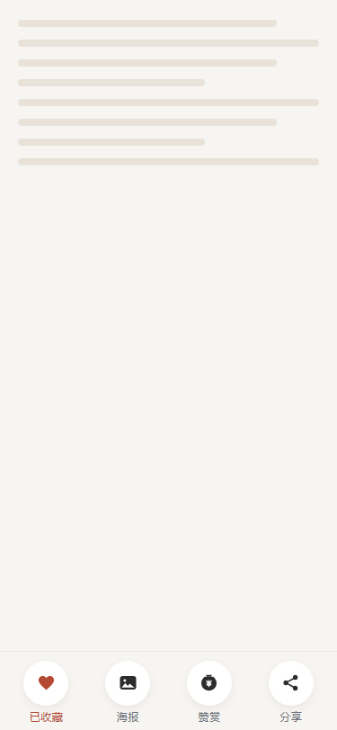
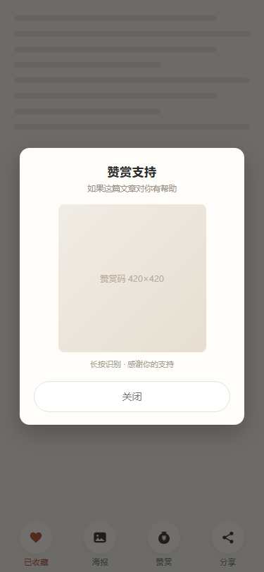
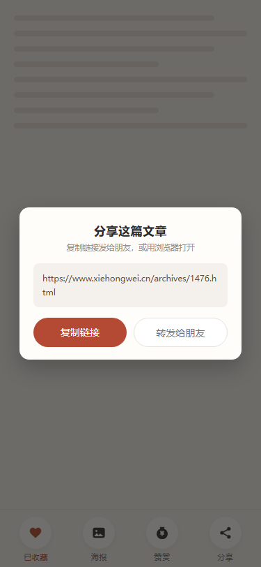
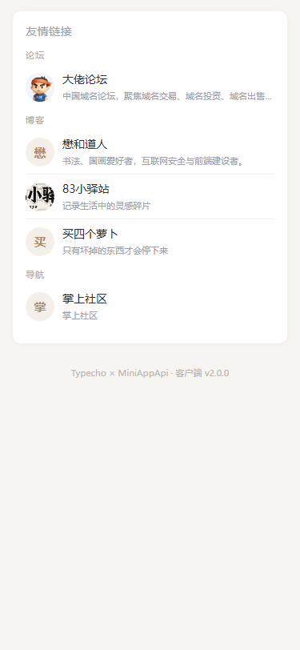

# typecho-harmonyhues-MiniAppApi

Typecho 博客（HarmonyHues 主题）的**微信小程序客户端 + API 服务端插件**。

小程序不是独立内容源：文章、分类、轮播、封面、一言、友链全部从现有 Typecho 站点读取，服务端插件负责把网页端已有内容转成小程序能用的 JSON，避免二次维护。

| 部分 | 版本 | 位置 |
|---|---|---|
| 服务端插件 MiniAppApi | 1.5.8 | `typecho-plugin/MiniAppApi/` |
| 微信小程序客户端 | v2.0.0 | `wx-miniprogram/` |
| 独立一言接口 | 1.0 | `yiyan-api/yiyan.php` |

## 功能

- **首页**：文章流（下拉刷新 / 上拉加载）+ 顶部轮播（自动引用网页端首页轮播）
- **分类页**：分类列表 + 分类封面大图，文章缩略图取网页端自定义缩略图
- **文章详情**：Markdown 渲染；底部四宫格 **收藏 / 海报 / 赞赏 / 分享**
  - 海报：3:2 封面图，二维码指向网页端文章页，文件名 `xiehongwei-<slug|post+id>-YYYYMMDD-HHmm.jpg`
  - 赞赏：弹出赞赏码（插件里配图，未配则自动隐藏按钮）
  - 分享：展示文章网址可一键复制 + 微信原生转发
- **归档**：封面 + 站点统计 + 按月文章列表
- **关于页**：一言卡片（纯本地诗词 txt + 图库配图，不依赖第三方 API）、归档入口、友情链接（抓取网页端 `/links.html`，仅展示链接）
- **我的**：邮箱验证码登录、收藏、浏览记录（WorkBuddy 云服务）

六个模块都可在插件设置里**单独开关**。

## 预览

| 文章页底部 | 赞赏弹窗 |
|---|---|
|  |  |

| 分享弹窗 | 关于页友情链接 |
|---|---|
|  |  |

## 目录结构

```
.
├── typecho-plugin/MiniAppApi/
│   ├── Plugin.php              插件主类：注册 /api/* 路由 + 后台设置表单
│   └── Action.php              接口实现：文章/配置/归档/一言/友链解析
├── wx-miniprogram/             微信小程序源码（开发者工具直接导入）
│   ├── config.js               唯一需要改的配置：站点地址 / token
│   ├── pages/                  首页 / 分类 / 关于 / 我的
│   ├── packagePost/            分包：文章详情、归档、海报与二维码生成
│   ├── components/             文章卡片、状态视图
│   ├── utils/                  请求封装、API、Markdown、用户数据
│   └── miniprogram_npm/        云服务 SDK 构建产物（无需再构建 npm）
├── yiyan-api/yiyan.php         独立一言 JSON 接口（单文件，可选）
└── docs/
    ├── 微信小程序部署说明.md      ← 完整部署步骤与各功能区细节
    ├── 更新日志.md
    └── 本地联调代理.js          模拟器跨域调试用的小代理
```

## 快速开始

### 1. 服务端

```bash
# 上传插件到 Typecho
usr/plugins/MiniAppApi/Plugin.php
usr/plugins/MiniAppApi/Action.php
```

后台 → 控制台 → 插件 → 启用 MiniAppApi → 设置里填 token。

验证：

```bash
curl "https://你的域名/api/ping"
# {"code":0,"data":{"version":"1.5.8",...}}
```

> 要求 Typecho 1.3.0、PHP 7.4+（需 curl 扩展）。

### 2. 小程序

1. 微信开发者工具导入 `wx-miniprogram/`，AppID 填自己的（`project.config.json` 里是占位符 `xxxxxxxx`）
2. 改 `config.js`：`apiBase`、`token`（与插件设置一致）
3. 编译预览
4. 上线前在 mp.weixin.qq.com 配置 **request** 与 **downloadFile** 合法域名

详细步骤（含每个功能区的部署要点、缓存时效、常见问题）见 **[docs/微信小程序部署说明.md](docs/微信小程序部署说明.md)**。

## 接口清单

| 接口 | 参数 | 说明 |
|---|---|---|
| `/api/ping` | — | 探活，返回插件 / PHP / Typecho 版本 |
| `/api/posts` | `page` `pageSize`(≤30) `category` `q` `token` | 文章列表 |
| `/api/post` | `id` 或 `slug` | 文章详情 |
| `/api/categories` | — | 分类及文章数 |
| `/api/config` | — | 站点信息 + 功能开关 + 轮播 + 封面 + 一言配图 + 赞赏码 + 友链 |
| `/api/archives` | — | 封面 + 统计 + 按月文章 |
| `/api/hitokoto` | — | 一言（本地 txt + 图库，可代理外站） |

## 设计要点

- **零二次维护**：轮播 / 分类封面 / 归档 / 友链都由服务端抓取自己站点的 HTML 再解析，网页端改了小程序自动跟着变（按缓存时效）。
- **一言不依赖官方 API**：默认只读服务器上的 `yiyan.txt` 与图库目录，断网也不影响卡片；外站接口只在显式配置时才代理。
- **头像与图片统一域名**：外站友链头像下载到 `usr/uploads/miniapp-links/` 后返回本站地址，规避小程序域名白名单；图片地址统一规范化为 `www.` 域名。
- **配置不丢**：插件启用时用表单默认值覆盖配置，代码里做了现有值回填。

## 注意

- `wx-miniprogram/project.config.json` 的 `appid` 与 `wx-miniprogram/config.js` 的 `token` 均已置为占位 / 空值，部署时填自己的，**不要提交真实 AppID 与密钥**。
- `utils/cloud.js` 里的 `publishableKey` 是云服务的公开密钥（客户端使用，数据由 RLS 隔离），可公开。
- 更新插件若涉及**新增路由**，必须在后台「禁用 → 启用」一次，否则新接口 404。

## License

MIT
